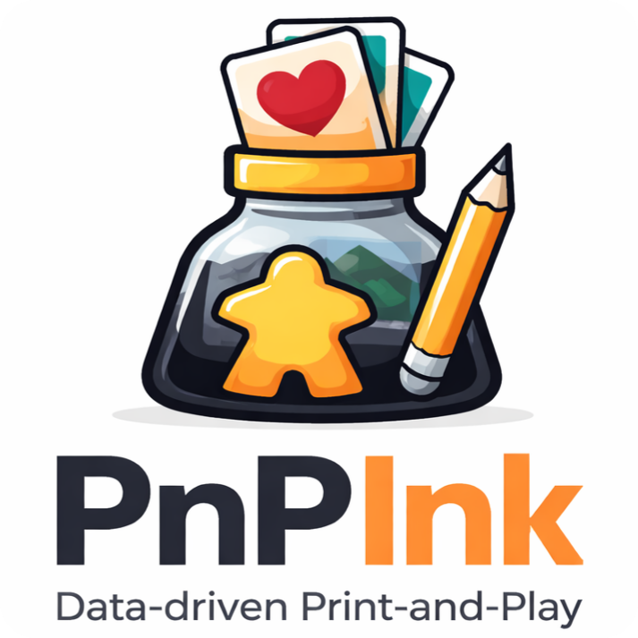
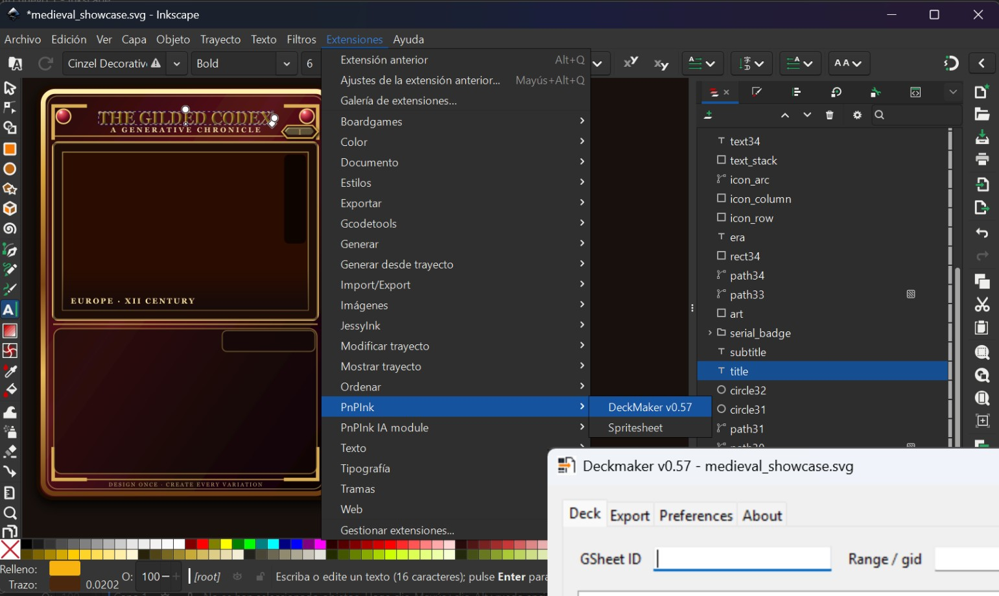
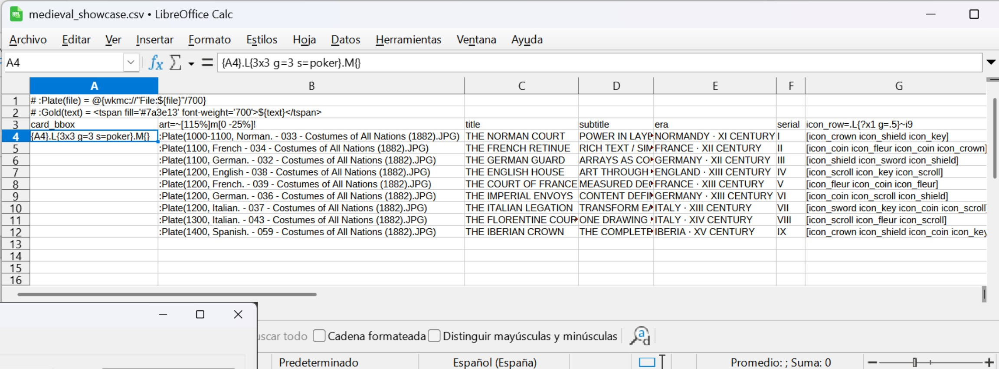
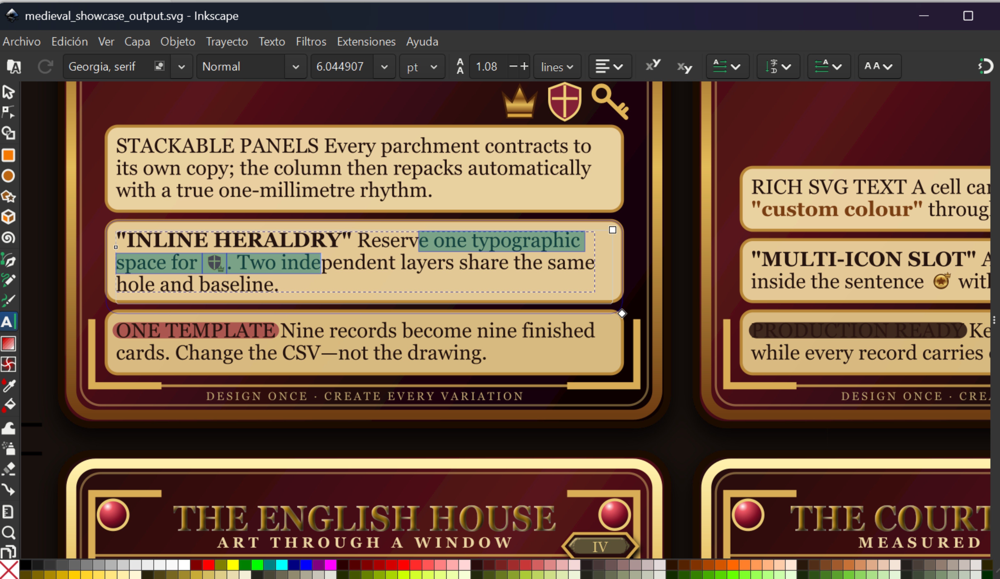
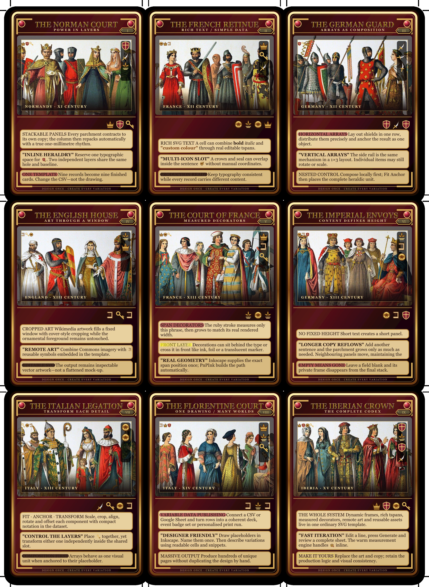

<p align="center">
  
</p>

<h1 align="center">PnPInk</h1>

<p align="center"><strong>Design once. Generate cards, badges, labels, and dynamic PDFs.</strong></p>

<p align="center">
  Connect Inkscape to Google Sheets or CSV and turn every row into finished artwork.
</p>

<p align="center">
  <a href="https://github.com/xoellijo/pnpink/releases"></a>
  <a href="LICENSE"></a>
  
  <a href="https://github.com/xoellijo/pnpink/stargazers"></a>
</p>

<p align="center">
  <a href="#install-pnpink"><strong>Install PnPInk</strong></a>
  ·
  <a href="https://xoellijo.github.io/pnpink/intro/"><strong>Read the documentation</strong></a>
  ·
  <a href="https://boardgamegeek.com/guild/4569"><strong>Join the community</strong></a>
</p>

---

## One Design, Hundreds of Variations

**Design in Inkscape. Add a spreadsheet. Generate your whole deck.**

Turn **one SVG template + Google Sheets or CSV** into cards, tokens, boards, badges, labels, or personalized PDFs. Change the design or data and regenerate every variation—without editing each item by hand. Your generated artwork stays **fully editable SVG**.

It is difficult to show everything PnPInk can do in a feature list. See it in action:

<p align="center">
  <a href="https://www.youtube.com/playlist?list=PLM5-7ajCwZAQ"><strong>▶ Watch the PnPInk video tutorials</strong></a>
</p>

<table>
  <tr>
    <td width="50%" align="center" valign="top">
      <a href="docs/assets/images/template.jpg" title="Design one reusable SVG template visually in Inkscape">
        
      </a><br />
      <sub><strong>Design once in Inkscape</strong></sub>
    </td>
    <td width="50%" align="center" valign="top">
      <a href="docs/assets/images/dataset-csv.jpg" title="Describe every card variation in an ordinary CSV spreadsheet">
        
      </a><br />
      <sub><strong>Drive variations from CSV or Google Sheets</strong></sub>
    </td>
  </tr>
  <tr>
    <td width="50%" align="center" valign="top">
      <a href="docs/assets/images/pnpink-output.jpg" title="Open the generated SVG in Inkscape and keep editing every element">
        
      </a><br />
      <sub><strong>Keep the generated SVG fully editable</strong></sub>
    </td>
    <td width="50%" align="center" valign="top">
      <a href="docs/assets/images/pnpink-output.pdf" title="Open the exported PDF; PnPInk can also export images and production formats">
        
      </a><br />
      <sub><strong>Export to PDF or any supported format</strong></sub>
    </td>
  </tr>
</table>

<p align="center"><em>One SVG template, one dataset, and every variation generated automatically.</em></p>

## Install PnPInk

Requires [Inkscape](https://inkscape.org/release/) **1.2 or newer** on Windows, macOS, or Linux. Sandboxed builds such as Flatpak are not supported.

Install the latest stable release with the command for your system:

**Windows:** press **Win+R**, paste this line, and press **Enter**. The command window stays open so you can read the result.

```bat
cmd /k "curl.exe -fL https://github.com/xoellijo/pnpink/releases/latest/download/pnpink_install.bat -o "%TEMP%\pnpink_install.bat" && call "%TEMP%\pnpink_install.bat""
```

**Linux / macOS:** paste this line into a terminal:

```sh
curl -fsSL https://github.com/xoellijo/pnpink/releases/latest/download/pnpink_install.sh | sh
```

Restart Inkscape, then open `Extensions > PnPInk`.

<details>
<summary>Alternative installation: download the installer or install manually</summary>

### Download the installer

Download `pnpink_install.bat` (Windows) or `pnpink_install.sh` (Linux/macOS) from the [latest release](https://github.com/xoellijo/pnpink/releases/latest):

- Windows: run `pnpink_install.bat` from CMD. It installs a private portable Ghostscript only when none is available; use `pnpink_install.bat --no-ghostscript` to skip this check.
- Linux/macOS: run `chmod +x pnpink_install.sh && ./pnpink_install.sh`.

### Manual installation

- Download and extract the `pnpink_payload_<version>.zip` file from the desired release.
- Copy its complete `src` folder into your Inkscape extensions directory and rename that folder to `pnpink`:
   - Windows: `%APPDATA%\inkscape\extensions\pnpink`
   - Linux and macOS: `~/.config/inkscape/extensions/pnpink`

</details>

## Visual Design, Powerful Automation

**The power of a data-driven generator, the ease of a visual workflow, and the full creative freedom of Inkscape.** Start without programming; add advanced automation only when you need it.

You design with real paths, typography, layers, gradients, filters, symbols, and masks—not a limited template editor. Nothing is locked into a proprietary format or flattened until you choose to export.

### From Your First Card to a Complete Project

1. **Design a template** in Inkscape. Give changing elements IDs such as `title`, `art`, or `back_art`, and use matching column names in CSV or Google Sheets.
2. **Open `Extensions > PnPInk > DeckMaker`.** Connect your dataset, or start with a prepared project from `Help > Examples`. Edit local CSV data and inspect synchronized previews as you iterate.
3. **Generate and export.** Produce editable SVG, a print-ready PDF, individual images, or cutting files. Update the data to rebalance cards; update the template to redesign the whole set.

The same workflow handles game components, modular maps, punchboards, and reference sheets—or variable-data publishing such as certificates, tickets, catalogs, and personalized badges. Portable `.pnp` packages keep the template, dataset, manifest, and assets together for sharing.

### Features That Grow with Your Project

- **Data-driven artwork:** local files, SVG symbols, Iconify icons, Wikimedia Commons images, public Google Drive files, and spritesheets, selected from your dataset.
- **Precise composition:** Fit + Anchor sizing and alignment, rich text with inline icons, and an optional compact DSL for advanced automation.
- **Reusable layouts:** page, card, layout, and export presets; automatic grids, margins, bleed, and cutting marks.
- **Fronts and backs:** duplex generation with mirrored print layouts, plus cutting templates for hand cutting or plotters such as Silhouette Cameo and Cricut.
- **Generated maps:** SVG maps from OpenStreetMap and OpenFreeMap sources.
- **Production exports:** PDF presets, PDF/X CMYK, ICC profiles, and smart filter rasterization; PNG, JPEG, TIFF, WebP, SVG, PS, EPS, EMF, and WMF output.
- **Larger projects:** output splitting, shared-resource optimization, and portable `.pnp` / `.zvg` packages.
- **No lock-in:** free, open source, cross-platform, and built around editable SVG and ordinary spreadsheets.

## Learn More

- [Introduction](https://xoellijo.github.io/pnpink/intro/) — understand the core workflow
- [Quick Start](https://xoellijo.github.io/pnpink/quickstart/) — build your first data-driven template
- [Deckmaker](https://xoellijo.github.io/pnpink/deckmaker-gui/) — generation and project controls
- [Export](https://xoellijo.github.io/pnpink/export/) — PDF, images, cutting files, and production options
- [Fit and Anchor](https://xoellijo.github.io/pnpink/dsl/fit-anchor/) — precise visual placement
- [Full PDF guide](https://xoellijo.github.io/pnpink/pnpink.pdf) — offline documentation

## Project Status

PnPInk is under active development and has been tested with Inkscape 1.2 through 1.5 on Windows, macOS, and Linux.

The next major step is integrating PnPPlay: a platform for playing and testing generated games locally or online through a complete design-to-play workflow.

## Community

Share projects, ask questions, suggest features, and help shape the roadmap in the [PnPInk BoardGameGeek Guild](https://boardgamegeek.com/guild/4569).

If PnPInk helps your project, consider giving the repository a ⭐. It makes the project easier for other creators to discover.

## Open Source

PnPInk is released under the [MIT License](LICENSE).
It was inspired by [CounterSheets](https://github.com/lifelike/countersheetsextension).
